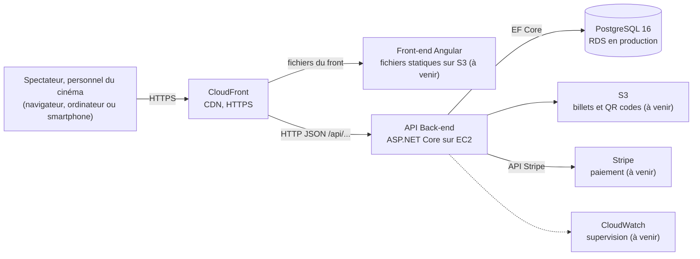
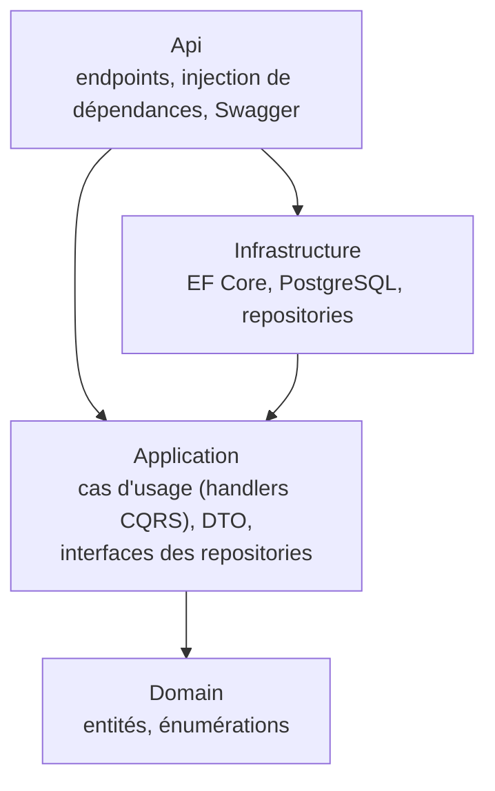

# Vue d'ensemble de l'architecture

Les éléments marqués _(à venir)_ sont décidés mais pas encore réalisés.

## Composants

| Composant | Rôle | Dépôt |
|---|---|---|
| CloudFront | CDN du Bloc 1 : HTTPS, une seule adresse ; oriente `/api/*` vers l'API et le reste vers les fichiers du front | configuration : [environnements](../deployment/environments.md) |
| Front-end (Angular) | application web (SPA) : programmation, compte, réservation, billets, écrans du personnel ; fichiers statiques sur S3 | [grand-cinema-frontend](https://github.com/Grand-Cinema-Studi/grand-cinema-frontend) |
| API Back-end (ASP.NET Core) | règles métier, sécurité, accès aux données ; aucune page HTML ; conteneur Docker sur EC2 | [grand-cinema-backend](https://github.com/Grand-Cinema-Studi/grand-cinema-backend) |
| PostgreSQL | utilisateurs, films, salles, places, séances, réservations | schéma : [erd.md](https://github.com/Grand-Cinema-Studi/grand-cinema-backend/blob/dev/docs/database/erd.md) |
| S3 (billets) | billets dématérialisés et QR codes (US 3.2), usage séparé du bucket du front | AWS |
| Stripe | paiement par carte ; aucune donnée de carte ne transite par l'application ni n'est stockée ; conformité PCI-DSS portée par Stripe | service tiers |
| CloudWatch | supervision : métriques, journaux, alertes | AWS |

Le front et l'API sont deux applications séparées qui ne communiquent que par HTTP et JSON : chacune a son dépôt et son pipeline, et se développe, se teste et se déploie seule (front : S3 + CloudFront ; API : EC2).

## Modules fonctionnels de l'API

Découpage issu du Bloc 1, réalisé progressivement user story par user story :

| Module | User stories | État |
|---|---|---|
| Programmation (consultation) | 1.1, 1.2 | ✅ `GET /api/schedule` |
| Authentification | 2.1 | développée sur sa branche (`POST /api/users`, `POST /api/tokens`, `GET /api/users/me`), fusion dans `dev` à venir |
| Réservation | 2.2, 2.3 | à venir |
| Paiement | 3.1 | à venir |
| Billets | 3.2, 4.1 | à venir |
| Administration | 5.1, 5.2, 5.3 | à venir |

## Architecture du backend

Clean Architecture en quatre projets ; les dépendances vont toujours vers le centre.

- **Domain** ne dépend de rien : ni du framework web, ni de la base.
- **Application** définit les interfaces dont elle a besoin (`IScreeningReadRepository`, …) ; **Infrastructure** les implémente. Les cas d'usage se testent donc sans base de données, avec des doublures.
- **CQRS** au niveau des opérations : chaque lecture est une requête (`IQueryHandler`), chaque modification une commande (`ICommandHandler`), traitée par son handler. Pas de bibliothèque, pas de bus de messages : un simple appel de méthode.
- **Api** ne contient aucune logique métier : un endpoint traduit la requête HTTP en requête ou commande CQRS, et renvoie le DTO en JSON.

Le parcours détaillé d'une requête est décrit dans le journal du backend ([from_scratch.md](https://github.com/Grand-Cinema-Studi/grand-cinema-backend/blob/dev/from_scratch.md), section « Parcours d'une requête dans le code »).

## Points d'architecture structurants

- **Pas de double vente** : les places sont bloquées dans une transaction PostgreSQL pendant le paiement, et une contrainte d'unicité `(séance, place)` refuse en base toute seconde vente, même en cas de bug applicatif. Pas de Redis : la base suffit au volume du cinéma. _(réservation à venir, US 2.3)_
- **Blocage limité dans le temps** : places libérées si le paiement n'est pas validé au bout de 10 minutes (paramétrable). _(à venir, US 2.3)_
- **Heure du cinéma** : les séances sont enregistrées à l'heure locale du cinéma (Europe/Paris) ; les instants techniques (création, expiration) en UTC.
- **Secrets hors du code** : aucun mot de passe ni clé dans les dépôts (voir [environnements](../deployment/environments.md)).

## Hébergement

| | Cible du Bloc 1 | Recette du projet (mise en ligne) |
|---|---|---|
| Fournisseur | AWS, région Paris (`eu-west-3`) | AWS, région Paris (`eu-west-3`), compte Free plan |
| Front-end | S3 + CloudFront | S3 + CloudFront |
| API Back-end | EC2 avec Auto Scaling pour les pics du festival | un serveur EC2, API en conteneur Docker |
| Base | RDS PostgreSQL (service géré) | PostgreSQL 16 en conteneur sur le serveur |
| HTTPS | de bout en bout | entre le navigateur et CloudFront ; HTTP entre CloudFront et le serveur, réservé à CloudFront |
| Raison de l'écart | — | budget nul ; l'API est sans état et son image Docker permet de passer à l'Auto Scaling et à RDS sans changer le code |

Détail : [deployment/environments.md](../deployment/environments.md) ; décision : [ADR 0003](../adr/0003-hosting-cloudfront-s3-ec2.md).

## Décisions liées

Les raisons de ces choix sont consignées dans les [ADR](../adr/README.md).
