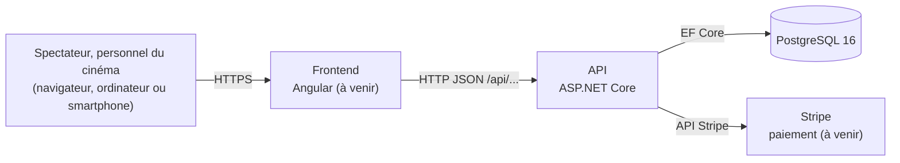
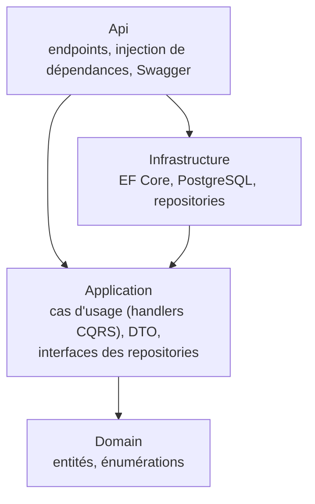

# Vue d'ensemble de l'architecture

Les éléments marqués _(à venir)_ sont décidés mais pas encore réalisés.

## Composants

| Composant | Rôle | Dépôt |
|---|---|---|
| Frontend | application web (SPA) : programmation, compte, réservation, billets, écrans du personnel | [grand-cinema-frontend](https://github.com/Grand-Cinema-Studi/grand-cinema-frontend) |
| API | règles métier, sécurité, accès aux données ; aucune page HTML | [grand-cinema-backend](https://github.com/Grand-Cinema-Studi/grand-cinema-backend) |
| PostgreSQL | utilisateurs, films, salles, places, séances, réservations | schéma : [erd.md](https://github.com/Grand-Cinema-Studi/grand-cinema-backend/blob/dev/docs/database/erd.md) |
| Stripe | paiement par carte ; aucune donnée de carte ne transite par l'application ni n'est stockée | service tiers |

Le front et l'API sont deux applications séparées qui ne communiquent que par HTTP et JSON : chacune se développe, se teste et se déploie seule.

## Modules fonctionnels de l'API

Découpage issu du Bloc 1, réalisé progressivement user story par user story :

| Module | User stories | État |
|---|---|---|
| Programmation (consultation) | 1.1, 1.2 | ✅ `GET /api/schedule` |
| Authentification | 2.1 | à venir |
| Réservation | 2.2, 2.3 | à venir |
| Paiement | 3.1 | à venir |
| Billets | 3.2, 4.1 | à venir |
| Administration | 5.1, 5.2, 5.3 | à venir |

## Architecture du backend

Clean Architecture en quatre projets ; les dépendances vont toujours vers le centre.

- **Domain** ne dépend de rien : ni du framework web, ni de la base.
- **Application** définit les interfaces dont elle a besoin (`IScreeningReadRepository`, …) ; **Infrastructure** les implémente. Les cas d'usage se testent donc sans base de données, avec des doublures.
- **CQRS** au niveau des opérations : chaque lecture est une requête (`IQueryHandler`), chaque modification une commande (`ICommandHandler`), traitée par son handler. Pas de bibliothèque, pas de bus de messages : un simple appel de méthode.
- **Api** ne contient aucune logique métier : un endpoint traduit la requête HTTP en requête ou commande CQRS, et renvoie le DTO en JSON.

Le parcours détaillé d'une requête est décrit dans le journal du backend ([from_scratch.md](https://github.com/Grand-Cinema-Studi/grand-cinema-backend/blob/dev/from_scratch.md), section « Parcours d'une requête dans le code »).

## Points d'architecture structurants

- **Pas de double vente** : les places sont bloquées dans une transaction PostgreSQL pendant le paiement, et une contrainte d'unicité `(séance, place)` refuse en base toute seconde vente, même en cas de bug applicatif. Pas de Redis : la base suffit au volume du cinéma. _(réservation à venir, US 2.3)_
- **Blocage limité dans le temps** : places libérées si le paiement n'est pas validé au bout de 10 minutes (paramétrable). _(à venir, US 2.3)_
- **Heure du cinéma** : les séances sont enregistrées à l'heure locale du cinéma (Europe/Paris) ; les instants techniques (création, expiration) en UTC.
- **Secrets hors du code** : aucun mot de passe ni clé dans les dépôts (voir [environnements](../deployment/environments.md)).

## Hébergement

| | Cible du Bloc 1 | Retenu pour la mise en ligne du projet |
|---|---|---|
| Fournisseur | AWS, région Paris (`eu-west-3`) | AWS, région Paris (`eu-west-3`), compte Free plan |
| Calcul | EC2, avec Auto Scaling pour les pics du festival | un serveur EC2, front, API et base en conteneurs Docker |
| Base | RDS PostgreSQL (service géré) | PostgreSQL 16 en conteneur |
| Raison | services gérés, montée en charge | budget nul ; l'image Docker de l'API permet de passer à RDS en changeant seulement la chaîne de connexion |

Détail : [deployment/environments.md](../deployment/environments.md).

## Décisions liées

Les raisons de ces choix sont consignées dans les [ADR](../adr/README.md).
