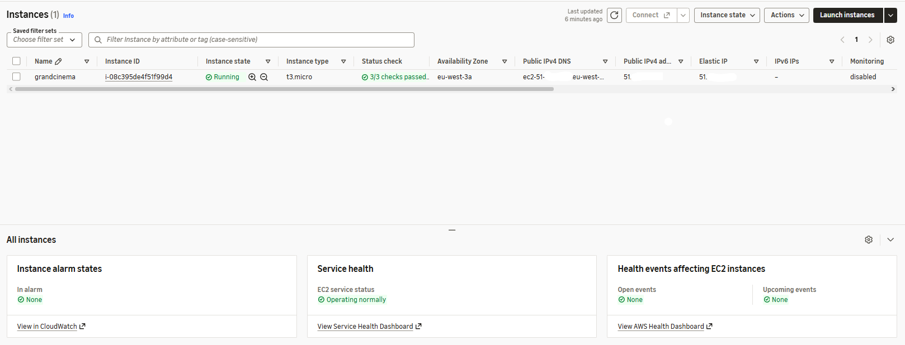
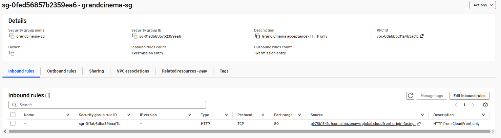
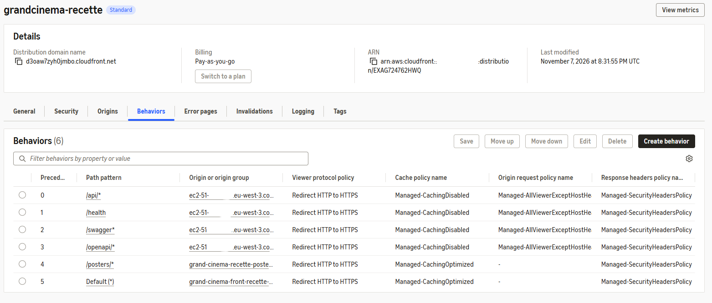
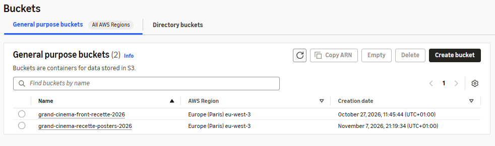
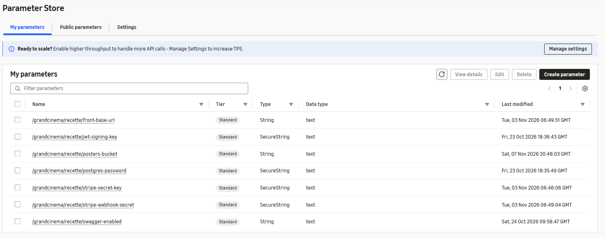
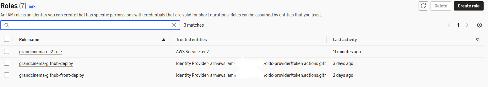
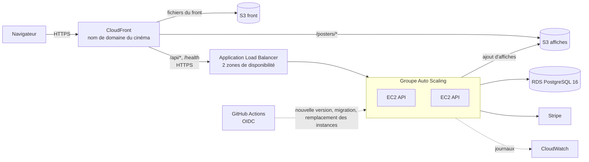

# Passage à l'architecture cible (V2)

Ce document dit **quand** et **comment** passer de la recette actuelle, version réduite décidée dans l'[ADR 0003](../adr/0003-hosting-cloudfront-s3-ec2.md), à l'architecture cible : répartiteur de charge (Application Load Balancer), Auto Scaling et RDS PostgreSQL.

En bref :

- **Quand** : en V2, au moment de monter la préproduction puis la production, et au plus tard un mois avant le premier Festival de Jazz avec vente en ligne.
- **Comment** : on ne transforme pas la recette, on monte la préproduction directement en cible, puis la production à l'identique.
- **Le code de l'application ne change pas** : aucun fichier de `src/` n'est modifié. Ce qui change, c'est l'infrastructure AWS, les fichiers de déploiement (`deploy/`) et le workflow GitHub Actions.

## 1. Point de départ : la recette (ADR 0003)

| Élément | Recette actuelle | Cible |
|---|---|---|
| Entrée | CloudFront (HTTPS), adresse `*.cloudfront.net` | CloudFront (HTTPS), nom de domaine du cinéma |
| API | un serveur EC2 `t3.micro`, Docker Compose | instances EC2 dans un groupe Auto Scaling, derrière un Application Load Balancer |
| Base | PostgreSQL 16 en conteneur sur le même serveur, sauvegarde `pg_dump` sur le disque | RDS PostgreSQL 16, sauvegardes automatiques |
| CloudFront → API | HTTP, serveur ouvert aux seules adresses de CloudFront | HTTPS vers le répartiteur de charge, ouvert aux seules adresses de CloudFront |
| Migrations | conteneur `migrate`, à chaque déploiement, sur le serveur | une seule fois par déploiement, avant le remplacement des instances |
| Supervision | journaux Docker sur le serveur | CloudWatch : journaux, métriques, alarmes |

Les services AWS utilisés aujourd'hui :

## 2. Quand : en V2

La recette reste en version réduite : son trafic est faible, et l'ADR 0003 vaut toujours pour elle. La cible est montée **pour la préproduction et la production**, que le Bloc 2 décrit sans les monter.

| Déclencheur | Pourquoi |
|---|---|
| Montage de la préproduction, premier sprint de la V2 | le [guide de déploiement](deploy-guide.md) exige une préproduction identique à la production : elle doit donc déjà être la cible |
| Au plus tard **un mois avant le premier Festival de Jazz** avec vente en ligne | le test de charge (200 utilisateurs simultanés, zéro double vente) doit passer en préproduction sur cette architecture, avant le gel de deux semaines qui précède le festival |
| Ouverture de la vente en ligne au public | un seul serveur est un point de panne unique : sa perte arrête la vente |

Ordre conseillé :

1. préproduction en cible ;
2. test de charge et test de panne ;
3. production identique ;
4. mise en ligne selon le [calendrier du guide de déploiement](deploy-guide.md#calendrier-de-mise-en-ligne).

## 3. Pourquoi le code ne change pas

| Propriété | Où le vérifier dans le code |
|---|---|
| L'API est sans état : aucune session en mémoire, le jeton JWT porte l'identité | clé de signature lue dans Parameter Store (`Jwt__SigningKey`), la même pour toutes les instances |
| Le blocage des places et l'anti-double vente sont en base | transaction PostgreSQL qui verrouille la séance (`SELECT … FOR UPDATE`) et contrainte d'unicité (séance, place) : deux instances ne peuvent pas vendre la même place ([bug 0001](../quality/bugs/0001-double-booking.md)) |
| Aucune tâche de fond | aucun `AddHostedService` : l'expiration des 10 minutes se calcule à la lecture. Deux instances ne font jamais le même travail en double |
| Les affiches sont sur S3, pas sur le disque | `IPosterStorage`, implémentation S3 choisie par configuration |
| Le webhook Stripe peut arriver sur n'importe quelle instance | il ne lit et n'écrit que la base |
| La santé de l'API est exposée | `/health`, utilisé par le groupe cible du répartiteur de charge |
| La base est choisie par configuration | `ConnectionStrings__Default` : passer à RDS revient à changer cette valeur dans Parameter Store |

## 4. Architecture cible

## 5. Comment : les étapes

Toutes les ressources sont dans la région Paris (`eu-west-3`), sauf le certificat de CloudFront, qui doit être dans `us-east-1`. Elles sont nommées `grandcinema-<environnement>-<rôle>` (exemple : `grandcinema-preprod-alb`).

### Étape 1 : nom de domaine et certificats

- Nom de domaine du cinéma (exemple : `legrandcinema.fr`), géré dans Route 53 ou chez le registraire.
- **AWS Certificate Manager** (gratuit) :
  - un certificat dans `us-east-1` pour CloudFront (`www.legrandcinema.fr`) ;
  - un certificat dans `eu-west-3` pour le répartiteur de charge (`origin.legrandcinema.fr`).
- Pourquoi : CloudFront ne parle HTTPS au répartiteur de charge que si son certificat correspond au nom appelé. L'adresse `*.elb.amazonaws.com` ne peut pas en recevoir. C'est ce qui supprime le tronçon HTTP de la recette.

### Étape 2 : RDS PostgreSQL

- **RDS → Créer une base de données** :
  - PostgreSQL 16, `db.t4g.micro`, 20 Go gp3 ;
  - sauvegardes automatiques sur 7 jours, chiffrement activé ;
  - pas d'accès public.
- **Haute disponibilité** : un seul serveur (Single-AZ) en préproduction. En production, Multi-AZ (base de secours dans une autre zone, bascule automatique) est une décision du Product Owner, car elle double le coût de la base.
- **Groupe de sécurité de la base** : port 5432 ouvert au seul groupe de sécurité des instances de l'API.
- **Parameter Store** :
  - `/grandcinema/<env>/connection-string` : `Host=<point de terminaison RDS>;Port=5432;Database=grandcinemadb;Username=…;Password=…;SSL Mode=Require`, en paramètre chiffré (SecureString) ;
  - `SSL Mode=Require` est un réglage de la chaîne de connexion, pas du code.
- **Données** : la préproduction et la production partent d'une base vide, créée par les migrations. Si un jour on voulait aussi passer la recette en cible, on y exporterait la base du conteneur (`pg_dump`), puis on l'importerait dans RDS (`pg_restore`), pendant une courte coupure annoncée.

### Étape 3 : modèle de lancement des instances

- **EC2 → Modèles de lancement** :
  - Amazon Linux 2023, `t3.micro` (ou `t3.small` si le test de charge le demande) ;
  - rôle `grandcinema-<env>-ec2-role` ;
  - IMDSv2 obligatoire, limite de sauts à 2, comme sur la recette.
- **Rôle de l'instance** : les droits actuels (Parameter Store en lecture sur `/grandcinema/<env>/*`, Session Manager, `s3:PutObject` sur `posters/*`), plus l'écriture des journaux dans CloudWatch Logs.
- **Données utilisateur** (script de démarrage) : installer Docker, lire les paramètres, puis démarrer **le seul conteneur de l'API**, sans `db` ni `migrate`. Ce fichier remplace `docker-compose.prod.yml` pour cet environnement (`deploy/docker-compose.asg.yml`), avec le pilote de journaux `awslogs` vers le groupe `/grandcinema/<env>/api`.
- **La version déployée est écrite dans le modèle.** Chaque déploiement crée une nouvelle version du modèle de lancement, avec l'étiquette de l'image (`ghcr.io/grand-cinema-studi/grand-cinema-backend:<commit>`). Une instance ajoutée par l'Auto Scaling démarre donc toujours la bonne version.

### Étape 4 : groupe cible et répartiteur de charge

- **EC2 → Groupes cibles** :
  - type « Instances », HTTP 80 ;
  - vérification de santé sur `/health` (code 200, toutes les 15 s, 2 succès pour être sain, 3 échecs pour être retiré) ;
  - délai de retrait (*deregistration delay*) de 30 s.
- **EC2 → Équilibreurs de charge → Application Load Balancer** :
  - accessible depuis Internet, dans **deux zones de disponibilité** ;
  - écouteur HTTPS 443 avec le certificat de l'étape 1, qui transmet au groupe cible.
- **Groupes de sécurité** :
  - répartiteur de charge : 443 ouvert à la seule liste de préfixes gérée de CloudFront (`com.amazonaws.global.cloudfront.origin-facing`), comme le serveur de la recette aujourd'hui ;
  - instances : 80 ouvert au seul groupe de sécurité du répartiteur de charge.
- **Attribut à régler :** traitement de l'en-tête `X-Forwarded-For` en mode **`preserve`**. Voir « Pièges », point 1.
- **Sessions persistantes (*sticky sessions*) désactivées** : l'API est sans état, chaque requête peut aller à n'importe quelle instance.

### Étape 5 : groupe Auto Scaling

- **EC2 → Groupes Auto Scaling** :
  - modèle de lancement de l'étape 3, version « Latest » ;
  - les deux zones du répartiteur de charge ;
  - groupe cible de l'étape 4 ;
  - vérification de santé par le répartiteur de charge (ELB), avec 120 s de délai de grâce au démarrage.
- **Capacité** :

| | Minimum | Souhaitée | Maximum |
|---|---|---|---|
| Préproduction | 1 | 1 | 3 |
| Production, hors festival | 2 | 2 | 4 |
| Production, pendant le festival | 3 | 3 | 6 |

- **Règles de mise à l'échelle** :
  - **suivi de cible** (*target tracking*) sur l'utilisation moyenne du processeur à 60 % : AWS ajoute ou retire des instances tout seul ;
  - **actions planifiées** pour le festival : la veille, minimum à 3 ; le lendemain de la clôture, retour à 2. Les pics du festival sont connus à l'avance : on les anticipe au lieu de les subir. C'est l'objectif « anticiper les pics d'affluence » de l'énoncé.
- Le minimum de 2 en production supprime le point de panne unique. Si une instance tombe, l'autre sert pendant que l'Auto Scaling la remplace.

### Étape 6 : CloudFront

- **Origine** : dans la distribution de l'environnement, nouvelle origine `origin.legrandcinema.fr` (le répartiteur de charge), protocole **HTTPS uniquement**.
- **Comportements** : `/api/*`, `/health`, `/swagger*` et `/openapi/*` vers cette origine, avec les mêmes réglages qu'en recette (cache désactivé, en-tête `Authorization` et toutes les méthodes transmis).
- **Nom de domaine** : nom alternatif `www.legrandcinema.fr`, avec le certificat `us-east-1`.
- **Inchangés** : les comportements du front et de `/posters/*`, et la fonction `spa-rewrite`.

### Étape 7 : pipeline de déploiement

Le workflow `deploy.yml` du back-end reçoit, pour les environnements `preproduction` et `production`, une variante qui remplace l'envoi de commande à une instance unique (`EC2_INSTANCE_ID`) :

1. tests, puis construction et publication de l'image (inchangé) ;
2. **migrations, une seule fois**, en commande Systems Manager sur une instance en service : `docker run --rm <image> /app/efbundle --connection "<chaîne RDS>"`. Elles passent avant la nouvelle version, et restent compatibles avec l'ancienne ([règle du guide](deploy-guide.md#revenir-en-arrière)) ;
3. nouvelle version du modèle de lancement avec l'étiquette de l'image ;
4. **remplacement progressif des instances** (*instance refresh*), avec 100 % de capacité saine minimum et retour automatique en arrière (*auto rollback*) si les nouvelles instances échouent à la vérification de santé ;
5. contrôle de `/health` à travers CloudFront (inchangé).

L'accès de GitHub à AWS reste en OIDC. Le rôle du back-end reçoit les droits sur ce modèle de lancement et ce groupe Auto Scaling, et plus aucun droit d'envoyer des commandes à une instance nommée.

### Étape 8 : supervision CloudWatch

| Alarme | Seuil indicatif |
|---|---|
| Répartiteur de charge : erreurs 5xx des cibles | plus de 1 % des requêtes sur 5 min |
| Répartiteur de charge : temps de réponse des cibles (p95) | plus de 2 s sur 5 min, la limite du critère de performance |
| Groupe cible : instances en mauvaise santé | au moins 1 pendant 5 min |
| RDS : processeur, connexions, espace libre | 80 % du processeur ; espace libre sous 2 Go |
| Groupe Auto Scaling : maximum atteint | capacité égale au maximum : relever le maximum ou changer de type d'instance |

Un tableau de bord réunit ces métriques, les journaux de l'API (`/grandcinema/<env>/api`) et les 5xx de CloudFront.

## 6. Pièges connus

1. **`X-Forwarded-For` et la limitation de débit**
   - L'API lit l'adresse du visiteur dans la dernière entrée de cet en-tête (`UseForwardedHeaders`, une entrée). Aujourd'hui, CloudFront y écrit l'adresse du visiteur.
   - Avec le répartiteur de charge au milieu, en mode par défaut (`append`), l'en-tête devient `visiteur, serveur CloudFront`. L'API compterait alors les tentatives de connexion par serveur CloudFront, ce qui bloquerait des visiteurs qui n'y sont pour rien.
   - Le mode **`preserve`** laisse l'en-tête tel que CloudFront l'a écrit. Aucun changement de code.
2. **La limitation de débit est en mémoire, par instance**
   - Elle autorise 10 tentatives par minute et par adresse sur les routes d'authentification.
   - Avec N instances, un attaquant dispose en pratique de jusqu'à N × 10 tentatives par minute. L'effet est acceptable pour 2 à 6 instances.
   - Si une limite stricte devenait nécessaire, une règle AWS WAF à débit limité sur CloudFront la porterait sans toucher au code.
3. **Les migrations au démarrage**
   - Sur la recette, le conteneur `migrate` tourne à chaque `docker compose up`.
   - Dans un groupe Auto Scaling, chaque instance lancée le relancerait, parfois plusieurs en même temps.
   - D'où l'étape 7 : migrations lancées une seule fois par le pipeline, et le service `migrate` absent de `docker-compose.asg.yml`.
4. **Le coût caché du réseau**
   - Des instances dans des sous-réseaux privés auraient besoin d'une passerelle NAT pour télécharger l'image : environ 35 €/mois de plus.
   - On garde des sous-réseaux publics, mais des groupes de sécurité qui n'ouvrent les instances qu'au répartiteur de charge.
   - Les adresses IPv4 publiques sont facturées : celles des instances, et deux pour le répartiteur de charge.
5. **Le billet n'a pas besoin du bucket S3 prévu au Bloc 1** : voir l'écart justifié dans [environnements](environments.md#mise-en-ligne-retenue-pour-le-projet--la-recette). Rien à faire pour la cible.

## 7. Vérifier

| Contrôle | Comment | Attendu |
|---|---|---|
| Parcours complet | test de fumée du [guide de déploiement](deploy-guide.md#vérifier-après-déploiement-test-de-fumée), par le nom de domaine | réservation, paiement en mode test, billet, scan |
| Répartition | journaux CloudWatch pendant le test de charge | les requêtes se répartissent sur toutes les instances |
| Panne d'une instance | arrêter une instance à la main | le répartiteur de charge la retire, l'Auto Scaling la remplace, aucune requête en erreur visible côté utilisateur |
| Montée en charge | JMeter, 200 utilisateurs simultanés, données d'un an d'exploitation | 95 % des requêtes en moins de 2 s, nouvelles instances ajoutées, **zéro double vente** |
| Limitation de débit | 11 tentatives de connexion en une minute depuis un même poste | `429` à la 11ᵉ, pour ce poste seulement |
| Retour arrière | déployer volontairement une image dont `/health` échoue | le remplacement s'arrête et revient à la version précédente |

## 8. Coût et décision

Ordre de grandeur mensuel en région Paris, au tarif à la demande : il est à confirmer avec le [calculateur de prix AWS](https://calculator.aws/) au moment de la décision.

| Poste | Préproduction (1 instance, Single-AZ) | Production (2 instances, Multi-AZ) |
|---|---|---|
| Application Load Balancer (heures et unités de capacité) | ~ 20 à 25 € | ~ 20 à 25 € |
| EC2 `t3.micro` | ~ 8 € | ~ 16 € (plus pendant le festival) |
| RDS `db.t4g.micro`, 20 Go | ~ 15 € | ~ 30 € |
| Adresses IPv4 publiques | ~ 10 € | ~ 14 € |
| CloudWatch, nom de domaine | quelques € | quelques € |
| **Total** | **~ 55 à 60 €/mois** | **~ 85 à 95 €/mois** |

La préproduction n'est allumée que pour valider une release : son coût réel est une fraction de ce total.

Le Bloc 1 estimait l'hébergement AWS de la solution retenue à 420 à 600 €/an. La production en cible complète, avec la base Multi-AZ et deux instances, dépasse cette estimation. Deux options sont présentées au Product Owner :

- **Production économique** : minimum d'une instance hors festival, base Single-AZ. On revient vers la fourchette du Bloc 1. Une panne coûte quelques minutes de coupure, le temps que l'Auto Scaling remplace l'instance.
- **Production haute disponibilité** : 2 instances minimum, base Multi-AZ. Plus de point de panne unique, pour environ le double.

## 9. Revenir en arrière

- **Une version** : le remplacement des instances revient seul à la version précédente si les nouvelles échouent. Sinon, on relance le déploiement du commit précédent.
- **Toute la cible** : tant que la production n'est pas ouverte, on remet l'origine précédente dans CloudFront. Les migrations ne sont jamais annulées : la base RDS reste compatible avec la version précédente de l'API.

## Captures

Les captures sont dans [`images/target-migration/`](images/target-migration/). Elles ne montrent jamais une valeur secrète : dans Parameter Store, seuls les noms des paramètres apparaissent.

| Fichier | Où dans la console AWS | Ce qu'on doit voir |
|---|---|---|
| `01-ec2-instance.png` | EC2 → Instances | l'instance de la recette, `t3.micro`, `eu-west-3`, en cours d'exécution |
| `02-security-group.png` | EC2 → Groupes de sécurité → onglet Règles entrantes | HTTP 80 ouvert à la seule liste de préfixes CloudFront |
| `03-cloudfront-behaviors.png` | CloudFront → la distribution → onglet Comportements | `/posters/*`, `/api/*`, `/health`, `/swagger*`, `/openapi/*` et le comportement par défaut |
| `04-s3-buckets.png` | S3 → Compartiments | le bucket du front et celui des affiches, accès public bloqué |
| `05-ssm-parameters.png` | Systems Manager → Parameter Store | les paramètres `/grandcinema/recette/*`, type SecureString, **valeurs masquées** |
| `06-iam-roles.png` | IAM → Rôles | les rôles OIDC du front et du back, et `grandcinema-ec2-role` |

Les captures des services de la cible (répartiteur de charge, groupe Auto Scaling, RDS) seront ajoutées lors de leur mise en place, en V2.
